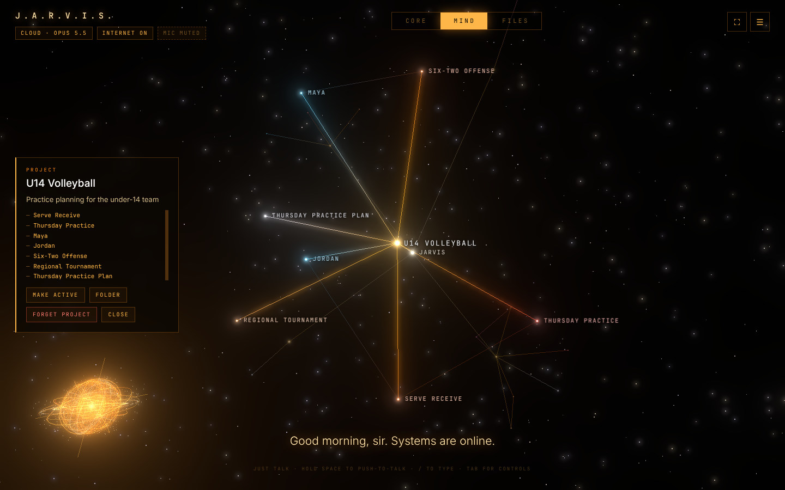
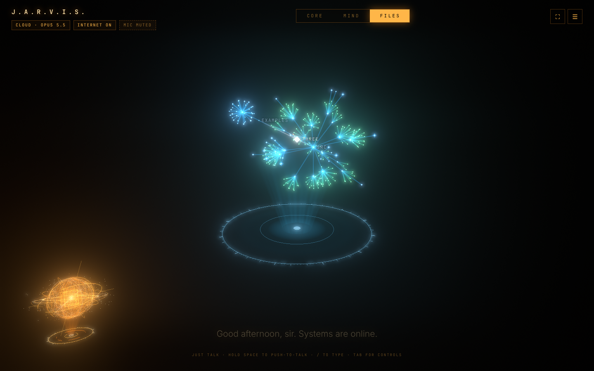

# J.A.R.V.I.S.

A voice-first personal AI for your desktop. Full screen, an orange hologram you talk to, and two 3D maps projected above a holographic table: one of everything it knows, one of your files.


## Run it

```bash
npm install
```

```bash
npm start
```

`npm run dev` opens it in a window instead of full screen. F11 (or `F`) toggles full screen.

Requires Node 20+. The first launch downloads the speech models (about 170 MB, once) — you'll see progress in the top-left corner. It then fetches a larger, faster copy of the voice in the background (about 325 MB, once) and switches to it when ready. `npm install` also brings the Claude Agent SDK with its own copy of Claude Code (about 400 MB); Jarvis prefers the `claude` you already have and falls back to that copy.

### Give it a brain

If you use [Claude Code](https://claude.com/claude-code) and are signed in to it, there is nothing to set up: Jarvis thinks through that sign-in. No API key.

Press **Tab** to open the controls to change it. Under **Brain**:

- **Cloud** — Claude (Opus 5.5 by default; Sonnet, Haiku and Fable are in the dropdown; Haiku answers soonest). **Sign in with** chooses how:
  - **Claude login (Claude Code CLI)**, the default. Jarvis runs the `claude` program on your computer and uses the account it is signed in to, so replies count against that plan's limits. The line underneath says what it found — `Claude Code 2.1.332 found · signed in` — or what to do: install the CLI, or run `claude` in a terminal and sign in, then press **Re-check**. If `claude` is somewhere unusual, put its location in **Path to claude**.
  - **API key** — paste an Anthropic API key instead. It is stored encrypted with your OS keychain.
- **Local** — install [Ollama](https://ollama.com), pull a model that supports tools (`ollama pull qwen3`), and choose it from the list. Nothing leaves your machine.

You can flip between cloud and local at any time from the chip in the top-left corner; the conversation and memory carry over. The chip also says when the cloud brain cannot answer yet (`signed out`, `no Claude Code`, `no API key`).

With the Claude login, Jarvis uses Claude Code only as a way to reach the model. The model gets Jarvis's own tools and, with Internet access on, web search and page fetching — never Claude Code's shell, file editing or agents, and nothing from your Claude Code settings, instructions, hooks, skills, plugins or MCP servers. Jarvis's conversations do not appear among your Claude Code sessions, and your other Claude Code sessions cannot send it messages. Variables in your shell that would point Claude Code somewhere else (an API key, a gateway address, a Bedrock or Vertex switch) are not passed on: replies go to Anthropic on the Claude login, or not at all.

One thing Jarvis cannot leave out: on a computer where an organisation manages Claude Code, that organisation's policy (its managed settings) applies here too, and any hooks it sets are handed what you say and what Jarvis answers. The sign-in line says so when that is the case — `… signed in · managed by your organisation …` — and an API key or Local avoids it. If the policy requires its own MCP servers, or sends Claude Code to Bedrock, Vertex or a gateway instead of a Claude login, Jarvis does not use Claude Code at all and says to choose an API key or Local.

The sign-in is yours and for your own use; Anthropic's terms do not let an app hand a Claude login on to other people.

## Talking to it

Just talk. It listens continuously, works out when you've finished a thought, and answers out loud sentence by sentence as the reply is generated. Talk over it and it stops and listens.

| | |
|---|---|
| Hold **Space** | Push-to-talk (works even with hands-free off or the mic muted) |
| **/** or **Enter** | Type instead |
| **Esc** | Interrupt / close whatever is open |
| **M** | Mute the microphone |
| **1 2 3** | Core / Mind / Files view |
| **Tab** | Controls |

While you talk, the words it has caught so far appear under the hologram and settle into the final transcript when you stop (live captions use a small extra model, about 124 MB, fetched the first time you speak). Its own reply is captioned as it speaks: the part already said is bright, the rest dim.

Speech recognition (Whisper) and the voice (Kokoro, a British male voice by default) both run locally. If you use open speakers and it keeps interrupting itself, turn off "Let me interrupt while it is talking" under Voice, or use headphones.

The microphone and the speaker are chosen separately under **Voice** in the controls — a headset microphone with desk speakers, say. The meter beside the microphone shows what it hears and **Test** plays a tone through the speaker. If a chosen device is unplugged, Jarvis uses the system default until it comes back.

## What's on screen

- **Core** — the hologram. It breathes when idle, tightens its rings when it hears you, spins up while thinking, and its surface follows the voice when it speaks.
- **Mind** — a 3D map of what it knows. Projects are the double-ringed gold hubs; people, topics, facts, tasks and documents hang off them. Click any marker to see it, and **Forget** to delete it.
- **Files** — a 3D map of your folders (your home folder by default; change it under Files in the controls). Folders are diamonds, files are dots. Click a folder to open it further; click a file to see it in the app — pictures, 3D models (as a hologram or solid), PDFs, markdown, code, tables, audio and video — with buttons to have Jarvis summarize or transcribe it, or open it in its own app. Esc closes it.





You can also ask for these by voice: "show me my files", "pull up the volleyball project".

## Memory and projects

After each exchange a background step files anything durable — people, plans, preferences, decisions — into the mind map. That map is what gets put in front of the model, so:

- deleting a node (in the Mind view, in the controls, or by saying "forget about X") removes it from what Jarvis knows, including mentions in the saved conversation;
- related things are grouped into **projects** automatically when a conversation is clearly part of an ongoing effort ("let's plan practices for my U14 team", "I want to research home batteries").

Long work — a practice plan, research notes, a dataset — is written as a markdown document into the project's folder rather than read aloud. Jarvis tells you the gist and can open it.

## Skills and connections

- **Skills** are plain-language instructions Jarvis loads when a task calls for them. Three ship by default (practice planner, research collector, daily briefing). Add your own in the controls, or import any folder containing a `SKILL.md`.
- **Connections** are [MCP servers](https://modelcontextprotocol.io) — add one by command (`npx -y @modelcontextprotocol/server-filesystem ~/Documents`) or by URL, and its tools become available immediately. Command-type servers run as programs on your computer with your permissions, so only add ones you trust.
- **Internet access** is a single switch (top-left chip). Off means no search or page fetching tools are offered to the model at all.

## Privacy

- Local mode: everything stays on the machine.
- Cloud mode: what you say, the memory summary, and tool results (including any file contents Jarvis reads at your request) are sent to Anthropic — through your Claude login or your API key, whichever is chosen.
- With the Claude login, the Claude Code program adds a little of its own to each request: the account's email address, and a note of the operating system, the date and the (empty) folder inside Jarvis's data folder that it runs in. Pages are fetched from this computer rather than by Anthropic. It keeps no transcript, and nothing is remembered between one reply and the next except what Jarvis's own memory puts in front of it — so what you delete is gone there too.
- With the Claude login on a computer whose Claude Code is managed by an organisation, that organisation's policy still applies: hooks it sets receive what you say together with the memory summary sent along, the inputs of the tools Jarvis uses, and the reply, and its settings can turn on its own logging. Jarvis shows this under Brain and when it starts; it cannot switch it off. An API key or Local is not subject to it.
- File tools are confined to the folder you choose; they can read and open, never write or delete. Jarvis only writes inside its own project folders.
- All data lives in the app's data folder (shown under System in the controls).

## Development

```bash
npm test
```

```
src/main/        Electron main process: agent loop, memory graph, tools, MCP, file scan, speech process
src/main/llm/    The brains: Claude through the Claude Code login or an API key (cloud), Ollama (local)
src/renderer/    The window: hologram, 3D graphs, voice loop, HUD and controls
```
