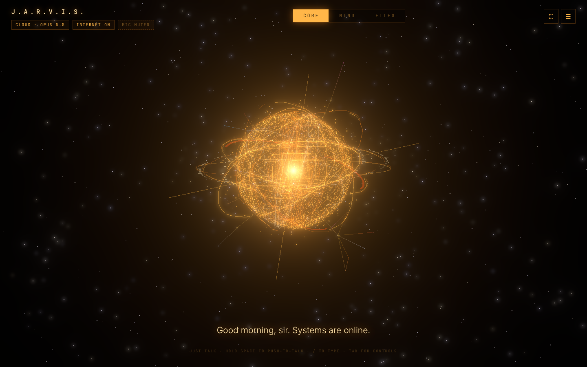

# J.A.R.V.I.S.

A voice-first personal AI for your desktop. Full screen, an orange hologram you talk to, and two 3D maps floating in space: one of everything it knows, one of your files.



## Run it

```bash
npm install
```

```bash
npm start
```

`npm run dev` opens it in a window instead of full screen. F11 (or `F`) toggles full screen.

Requires Node 20+. The first launch downloads the speech models (about 170 MB, once) — you'll see progress in the top-left corner.

### Give it a brain

Press **Tab** to open the controls, then under **Brain** pick one:

- **Cloud** — paste an Anthropic API key. Uses Claude (Opus 5.5 by default; Sonnet, Haiku and Fable are in the dropdown). The key is stored encrypted with your OS keychain.
- **Local** — install [Ollama](https://ollama.com), pull a model that supports tools (`ollama pull qwen3`), and choose it from the list. Nothing leaves your machine.

You can flip between them at any time from the chip in the top-left corner; the conversation and memory carry over.

## Talking to it

Just talk. It listens continuously, works out when you've finished a thought, and answers out loud sentence by sentence as the reply is generated. Talk over it and it stops and listens.

| | |
|---|---|
| Hold **Space** | Push-to-talk (works even with hands-free off or the mic muted) |
| **/** or **Enter** | Type instead |
| **Esc** | Interrupt / close whatever is open |
| **M** | Mute the microphone |
| **1 2 3** | Core / Mind / Files view |
| **Tab** | Controls |

Speech recognition (Whisper) and the voice (Kokoro, a British male voice by default) both run locally. If you use open speakers and it keeps interrupting itself, turn off "Let me interrupt while it is talking" under Voice, or use headphones.

## What's on screen

- **Core** — the hologram. It breathes when idle, tightens its rings when it hears you, spins up while thinking, and its surface follows the voice when it speaks.
- **Mind** — a 3D map of what it knows. Projects are the gold hubs; people, topics, facts, tasks and documents hang off them. Click any dot to see it, and **Forget** to delete it.
- **Files** — a 3D map of your folders (your home folder by default; change it under Files in the controls). Click a folder to open it further; click a file to open or reveal it.

You can also ask for these by voice: "show me my files", "pull up the volleyball project".

## Memory and projects

After each exchange a background step files anything durable — people, plans, preferences, decisions — into the mind map. That map is what gets put in front of the model, so:

- deleting a node (in the Mind view, in the controls, or by saying "forget about X") removes it from what Jarvis knows, including mentions in the saved conversation;
- related things are grouped into **projects** automatically when a conversation is clearly part of an ongoing effort ("let's plan practices for my U14 team", "I want to research home batteries").

Long work — a practice plan, research notes, a dataset — is written as a markdown document into the project's folder rather than read aloud. Jarvis tells you the gist and can open it.

## Skills and connections

- **Skills** are plain-language instructions Jarvis loads when a task calls for them. Three ship by default (practice planner, research collector, daily briefing). Add your own in the controls, or import any folder containing a `SKILL.md`.
- **Connections** are [MCP servers](https://modelcontextprotocol.io) — add one by command (`npx -y @modelcontextprotocol/server-filesystem ~/Documents`) or by URL, and its tools become available immediately. Command-type servers run as programs on your computer with your permissions, so only add ones you trust.
- **Internet access** is a single switch (top-left chip). Off means no search or page fetching tools are offered to the model at all.

## Privacy

- Local mode: everything stays on the machine.
- Cloud mode: what you say, the memory summary, and tool results (including any file contents Jarvis reads at your request) are sent to Anthropic.
- File tools are confined to the folder you choose; they can read and open, never write or delete. Jarvis only writes inside its own project folders.
- All data lives in the app's data folder (shown under System in the controls).

## Development

```bash
npm test
```

```
src/main/        Electron main process: agent loop, memory graph, tools, MCP, file scan, speech process
src/main/llm/    The two brains: Anthropic (cloud) and Ollama (local)
src/renderer/    The window: hologram, 3D graphs, voice loop, HUD and controls
```
